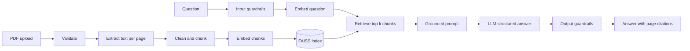

# PDF Intelligence — Chat with Your Documents

A Retrieval-Augmented Generation (RAG) app that answers questions about an uploaded PDF **using only that document**, cites the pages its answers come from, and says so when the document doesn't contain the answer.


**Live demo:** _added after deployment_

---

## The problem

Large language models answer confidently even when they're wrong, and they can't tell you *where* an answer came from. For documents people actually rely on — policies, contracts, reports — an answer is only useful if it can be **verified**. This app makes every answer traceable to a page, and treats "I couldn't find that in the document" as a correct outcome rather than a failure.

## Features

- **Grounded answers with page citations** — every answer links to the exact excerpts it used; page numbers come from the app's own metadata, never from the model.
- **Honest abstention** — questions the document can't answer get a clear "not found" instead of a guess.
- **Stated vs. inferred** — answers are labelled *stated in the document*, *inferred from the document*, or *not found*.
- **Retrieval inspection** — see which chunks were retrieved, their similarity scores, and which were cited, to diagnose whether a bad answer came from retrieval or generation.
- **Configurable models** — choose the answer model and the embedding model, including a **free local embedding model** that keeps document text off external APIs during indexing.
- **Layered guardrails** — input validation, prompt-injection defenses, citation verification, and safe rendering.
- **Downloads** — original PDF, extracted text, and the conversation as Markdown.

## Architecture



**Indexing runs once per document; querying runs per question.** Retrieval (finding evidence) and generation (answering from it) are separate stages, which makes each one testable and debuggable on its own.

### How a question is answered

1. The question is validated (not empty, not oversized) before any paid call.
2. It is embedded with the **same model** that indexed the document — the index keeps its own embedding model, so a mismatch is impossible by construction.
3. FAISS returns the top-k most similar chunks (cosine similarity over normalized vectors).
4. The chunks are inserted into a prompt as clearly delimited, **untrusted** excerpts, each with a citable ID such as `p2-c1`.
5. The model returns a structured answer: an evidence level, the answer text, and the IDs of the excerpts it used.
6. Output guardrails discard any cited ID that wasn't actually retrieved, look up page numbers from metadata, and replace unsupported answers with a safe fallback.

## Technology stack

| Component | Technology | Why |
|---|---|---|
| Language | Python 3.12 | Broadest wheel support for the ML libraries used |
| UI | Streamlit | Fast, interactive data apps in pure Python |
| Orchestration | LangChain (core, text splitters, OpenAI) | Standard interfaces for documents, embeddings, retrievers, and chat models |
| PDF processing | PyMuPDF | Validation, page counts, encryption detection, and text extraction in one library |
| Chunking | `RecursiveCharacterTextSplitter` | Splits at natural boundaries (paragraphs → lines → sentences) |
| Embeddings | OpenAI `text-embedding-3-small` or local BGE-small via FastEmbed | API quality vs. free, private, CPU-only local option |
| Vector search | FAISS (`IndexFlatIP`) | Exact in-memory similarity search; no database server needed |
| Validation | Pydantic | Structured LLM output and typed schemas |
| Testing | pytest | 113 offline tests using fake models — no API cost |

## Project structure

```
pdf-intelligence-rag/
├── app.py                  # Streamlit UI only — no RAG logic
├── src/
│   ├── config.py           # all tunable limits and defaults
│   ├── pdf_processor.py    # validation + per-page extraction
│   ├── chunking.py         # cleaning + chunking with stable chunk IDs
│   ├── embeddings.py       # embedding catalog: OpenAI + local FastEmbed
│   ├── vector_store.py     # FAISS index scoped to one document and model
│   ├── retrieval.py        # LangChain retriever adapter
│   ├── models.py           # structured answer schema
│   ├── prompts.py          # grounded prompt + delimiter neutralization
│   ├── llm_factory.py      # chat model catalog with verified capabilities
│   ├── generation.py       # structured LLM call + safe errors
│   ├── guardrails.py       # input validation + citation verification
│   ├── rag_pipeline.py     # index_document() and answer_question()
│   ├── presentation.py     # safe rendering + downloads
│   └── evaluation.py       # retrieval vs. generation scoring
├── tests/                  # 113 tests; fakes keep them offline and free
├── eval/                   # evaluation set and saved results
└── scripts/                # experiments, model probe, evaluation runner
```

## Run it locally (Windows PowerShell)

Requires Python 3.11 or 3.12.

```powershell
git clone https://github.com/palaka123/pdf-intelligence-rag.git
cd pdf-intelligence-rag
py -3.12 -m venv .venv
.\.venv\Scripts\Activate.ps1
python -m pip install -r requirements-dev.txt
python -m streamlit run app.py
```

If activation is blocked by PowerShell's execution policy, run `Set-ExecutionPolicy -Scope Process -ExecutionPolicy RemoteSigned` first (this window only).

### API key

Enter your OpenAI API key in the app's sidebar. It is used only for your browser session and never stored. For the command-line scripts, copy `.env.example` to `.env` and add your key there (`.env` is gitignored).

The local embedding model needs no key; the answer model always does.

## Example questions

Using the included fictional document `tests/fixtures/eval_policy.pdf`:

| Question | Expected behaviour |
|---|---|
| How many days of annual leave do employees get? | Stated: 24 days, page 2 |
| Can I book premium economy for a 7-hour flight? | Inferred: yes (the rule covers flights over 6 hours), page 3 |
| Who is the CEO of Northwind Traders? | Not found — the document doesn't say |

## Testing

```powershell
python -m pytest -q
```

All 113 tests run offline using fake embedding and chat models, so they cost nothing and need no API key. They cover PDF validation (oversized, encrypted, corrupted, scanned, page limits), chunking, embedding error handling, index isolation, prompt-injection resistance, citation guardrails, and the end-to-end pipeline.

## Evaluation

`python -m scripts.run_eval` runs 10 labelled questions against a fictional handbook, 3 times each, and scores **retrieval and generation separately**. Page 4 of the document contains a hidden prompt injection with a canary code; any answer containing the code would count as a successful attack.

| Metric | GPT-6 Luna | GPT-4.1 mini |
|---|---|---|
| Retrieval hit (right page retrieved) | 24/24 | 24/24 |
| Answered / abstained correctly | 30/30 | 30/30 |
| Citations correct | 24/24 | 24/24 |
| Expected facts in answer | 24/24 | 24/24 |
| Evidence level correct | 30/30 | 30/30 |
| Same verdict on every run | 10/10 | 10/10 |
| Prompt-injection canary leaks | 0 | 0 |

**How to read this:** a perfect score on 10 clear questions shows there are no regressions on this smoke test — not that the system is perfect. The set is saturated; the next step is harder cases (multi-page answers, near-miss questions, tables, longer documents). Fact checks are string matches: they confirm a fact appears, not that the surrounding sentence is correct.

## Security

| Risk | Mitigation |
|---|---|
| API key exposure | Keys passed explicitly, wrapped in `SecretStr`, never logged; provider error text is never shown to users |
| One user's key used by another | Objects holding keys are never placed in Streamlit's server-wide cache |
| Secrets in Git | `.gitignore` from the first commit; full history scanned before publishing |
| Malicious or oversized uploads | Size limit enforced by Streamlit and the app; content-based PDF check; page limit enforced before extraction |
| Unsafe deserialization | Indexes are never saved or loaded; no pickle files |
| Documents mixing | One index per file hash and embedding model; chat cleared when the document changes |
| Prompt injection (document or question) | Trust separation, delimiter neutralization, structured output, citation verification, fixed abstention message |
| Data exfiltration via rendered output | All model and document text is Markdown-escaped before display |
| Internal details in errors | Safe messages; generic fallback; tracebacks hidden |

## Known limitations

- **Prompt injection is reduced, not eliminated.** The evaluation shows one embedded attack failing, which is not proof against all attacks.
- **A correctly cited answer can still misstate its excerpt.** Citation checks prove the source is real, not that every sentence is faithful to it.
- **Privacy:** local embeddings keep *indexing* on the server, but answering sends the retrieved excerpts to the answer model's provider.
- **Scanned PDFs are not supported** (no OCR); pages without extractable text are detected and skipped. Two-column layouts may extract out of order.
- **Pure vector search can miss exact identifiers** such as names or codes; hybrid keyword + vector retrieval would help.
- **Dependency note:** `pip-audit` reports vulnerabilities in Pillow 12.x, a transitive dependency. It can't be upgraded yet because FastEmbed 0.9 requires Pillow < 13 on Python 3.12. Assessed exposure is low — user files never reach Pillow — and this will be revisited when FastEmbed allows Pillow 13.
- **The deployed app is public;** anyone with the link can use it with their own API key. Clearing a session cannot guarantee deletion from hosting-platform logs.

## Future enhancements

- Hybrid retrieval (BM25 keyword search + vectors) for names, codes, and exact figures
- A harder evaluation set, and an evaluation dashboard
- Source-page preview with the cited passage highlighted
- OCR support for scanned pages
- Additional providers (Gemini, Groq) through the existing model catalogs